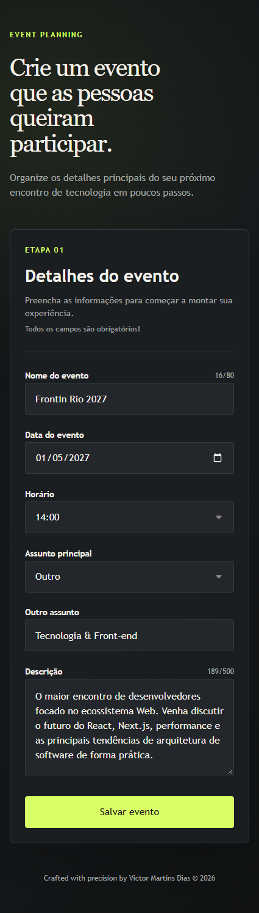

<div align="center">

# react-forms

Formulário responsivo para registro e validação dos detalhes de um evento.

</div>

<div align="center">

[](https://victormartinsd.github.io/react-forms/)
[](./docs/product-spec.md)
[](./docs/study-notes.md)
[](./LICENSE)

</div>

<a id="sumario"></a>

<div align="center">

## Sumário | Summary

| Português                                                                                                                                                                                                                                                                                                                                                                                                              | English                                                                                                                                                                                                                                                                                                                                                                                                          |
| ---------------------------------------------------------------------------------------------------------------------------------------------------------------------------------------------------------------------------------------------------------------------------------------------------------------------------------------------------------------------------------------------------------------------- | ---------------------------------------------------------------------------------------------------------------------------------------------------------------------------------------------------------------------------------------------------------------------------------------------------------------------------------------------------------------------------------------------------------------- |
| [Sobre o Projeto](#sobre-o-projeto)<br>[Preview](#preview)<br>[Visão de Produto](#visao-de-produto)<br>[Casos de Uso](#casos-de-uso)<br>[Funcionalidades](#funcionalidades)<br>[Tecnologias](#tecnologias)<br>[Arquitetura e Decisões Técnicas](#arquitetura-e-decisoes-tecnicas)<br>[Como Rodar Localmente](#como-rodar-localmente)<br>[Limitações Conhecidas](#limitacoes-conhecidas)<br>[Aprendizado](#aprendizado) | [About the Project](#about-the-project)<br>[Preview](#preview-english)<br>[Product Overview](#product-overview)<br>[Use Cases](#use-cases)<br>[Features](#features-english)<br>[Technologies](#technologies-english)<br>[Architecture and Technical Decisions](#architecture-and-technical-decisions)<br>[Running Locally](#running-locally)<br>[Known Limitations](#known-limitations)<br>[Learning](#learning) |

</div>

<a id="sobre-o-projeto"></a>

## 📌 Sobre o Projeto

O `react-forms` é uma aplicação frontend para registrar os dados essenciais de um evento em um formulário único. O fluxo valida campos obrigatórios, impede datas e horários indisponíveis e permite recuperar um preenchimento interrompido antes do envio.

O projeto foi desenvolvido para estudar formulários tipados, validação declarativa, estados derivados e persistência de rascunhos em uma aplicação React.

<div align="center">

<a id="preview"></a>

## 🖼️ Preview


<details>
  <summary>📱 Clique aqui para ver a versão Mobile</summary>
  <br>
  
</details>

</div>

<a id="visao-de-produto"></a>

## 🎯 Visão de Produto

O produto organiza o registro inicial de um evento, orientando o usuário na definição de nome, data, horário, assunto e descrição. As restrições de preenchimento reduzem combinações inválidas e preservam o rascunho quando o fluxo é interrompido.

O público-alvo inclui estudantes, desenvolvedores e organizadores de encontros de tecnologia que precisam estruturar os dados iniciais de um evento sem utilizar uma plataforma completa de gestão. Para detalhes sobre regras de negócio e requisitos, acesse a [Especificação de Produto](./docs/product-spec.md).

<a id="casos-de-uso"></a>

## 🧩 Casos de Uso

- Registrar os dados iniciais de um encontro de tecnologia.
- Definir uma data futura e escolher um horário compatível com o dia selecionado.
- Informar um assunto fora das opções principais por meio do campo personalizado.
- Retomar o preenchimento de um evento após sair da página.
- Validar os dados antes de concluir o registro.

<a id="funcionalidades"></a>

## ✨ Funcionalidades

- Registro do nome, data, horário, assunto e descrição do evento.
- Validação de campos obrigatórios e limites de caracteres.
- Disponibilidade de horários calculada de acordo com a data escolhida.
- Bloqueio de domingos e de datas anteriores ao dia seguinte.
- Campo condicional para assunto personalizado.
- Contadores de caracteres no nome e na descrição.
- Persistência local do rascunho durante o preenchimento.
- Limpeza do formulário e confirmação após o envio válido.
- Layout responsivo para diferentes larguras de tela.
- Mensagens de erro associadas aos respectivos campos.

<a id="tecnologias"></a>

## 🛠️ Tecnologias e Ferramentas

### Core

| Tecnologia               | Versão    | Função e impacto na arquitetura                                                                                                                     |
| ------------------------ | --------- | --------------------------------------------------------------------------------------------------------------------------------------------------- |
| **React**                | `^19.2.8` | Biblioteca de interface. Organiza a tela em componentes e atualiza o DOM conforme o estado do formulário.                                           |
| **React DOM**            | `^19.2.8` | Renderizador para o navegador. Monta a aplicação no elemento raiz em `main.tsx`.                                                                    |
| **TypeScript**           | `~6.0.2`  | Tipagem estática. Define o formato dos dados do formulário e do store, e o `tsc -b` do build bloqueia erros de tipo antes da publicação.            |
| **Vite**                 | `^8.3.0`  | Servidor de desenvolvimento com recarga rápida e build de produção. Configura o alias `@` para `src` e o `base` relativo exigido pelo GitHub Pages. |
| **@vitejs/plugin-react** | `^6.1.1`  | Integra o React ao Vite, habilitando JSX e Fast Refresh durante o desenvolvimento.                                                                  |

### Formulários e Validação

| Tecnologia              | Versão    | Função e impacto na arquitetura                                                                                                  |
| ----------------------- | --------- | -------------------------------------------------------------------------------------------------------------------------------- |
| **React Hook Form**     | `^7.53.2` | Mantém o estado de edição, o registro dos campos e o fluxo de submissão do formulário.                                           |
| **Yup**                 | `^1.5.0`  | Concentra o schema de validação: obrigatoriedade, limites de caracteres, data mínima, domingos indisponíveis e horários válidos. |
| **@hookform/resolvers** | `^3.9.1`  | Conecta o schema do Yup ao React Hook Form, aplicando as regras de validação ao formulário.                                      |

### Estado e Persistência

| Tecnologia  | Versão    | Função e impacto na arquitetura                                                                                                  |
| ----------- | --------- | -------------------------------------------------------------------------------------------------------------------------------- |
| **Zustand** | `^5.0.16` | Store do rascunho do evento. Persiste alterações parciais no armazenamento local do navegador e permite retomar o preenchimento. |

### Estilos

| Tecnologia | Versão | Função e impacto na arquitetura                                                                                                           |
| ---------- | ------ | ----------------------------------------------------------------------------------------------------------------------------------------- |
| **CSS**    | Nativo | Estilos em `App.css` e `global.css`: layout responsivo, reset, tipografia herdada e foco global, sem pré-processador ou biblioteca de UI. |

### Qualidade de Código

| Tecnologia                      | Versão     | Função e impacto na arquitetura                                                                               |
| ------------------------------- | ---------- | ------------------------------------------------------------------------------------------------------------- |
| **ESLint**                      | `^10.10.0` | Análise estática com configuração flat em `eslint.config.js`, executada por `npm run lint` e `npm run check`. |
| **@eslint/js**                  | `^10.0.1`  | Regras recomendadas do JavaScript (`js.configs.recommended`).                                                 |
| **typescript-eslint**           | `^8.69.0`  | Parser e regras recomendadas do ESLint para arquivos `.ts` e `.tsx`.                                          |
| **eslint-plugin-react-hooks**   | `^7.1.1`   | Regras dos Hooks do React, evitando dependências incorretas e uso indevido de Hooks.                          |
| **eslint-plugin-react-refresh** | `^0.5.6`   | Valida exports dos componentes para manter o Fast Refresh funcional no Vite.                                  |
| **eslint-config-prettier**      | `^10.1.8`  | Desativa regras do ESLint que conflitam com o Prettier.                                                       |
| **globals**                     | `^17.12.0` | Declara as variáveis globais do navegador para o ESLint.                                                      |
| **Prettier**                    | `^3.6.2`   | Padroniza a formatação. `npm run check` verifica e `npm run format` corrige.                                  |
| **@types/react**                | `^19.2.18` | Tipos do React para o TypeScript.                                                                             |
| **@types/react-dom**            | `^19.2.7`  | Tipos do React DOM para o TypeScript.                                                                         |
| **@types/node**                 | `^24.13.3` | Tipos do Node.js usados na configuração do Vite (`node:path` e `import.meta.dirname`).                        |

### Automação de Commits

| Tecnologia      | Versão    | Função e impacto na arquitetura                                                                                                        |
| --------------- | --------- | -------------------------------------------------------------------------------------------------------------------------------------- |
| **Husky**       | `^9.1.7`  | Instala os Git hooks pelo script `prepare`. O hook `pre-commit` executa o lint-staged.                                                 |
| **lint-staged** | `^16.2.7` | Roda `eslint --fix` e `prettier --write` apenas nos arquivos em stage (`.ts`, `.tsx`, `.js`, `.jsx`) e `prettier --write` nos `.html`. |

### Runtime, Pacotes e Deploy

| Tecnologia         | Versão     | Função e impacto na arquitetura                                                                                                               |
| ------------------ | ---------- | --------------------------------------------------------------------------------------------------------------------------------------------- |
| **Node.js**        | `>=24.0.0` | Runtime exigido em `engines` e usado no workflow de deploy. Executa Vite, TypeScript e as ferramentas de qualidade.                           |
| **npm**            | Lockfile   | Instala as dependências e registra as versões resolvidas em `package-lock.json`. O workflow usa `npm ci` para builds reproduzíveis.           |
| **GitHub Actions** | Workflow   | Workflow de deploy executado a cada push em `main` ou `master` (ou manualmente): instala com `npm ci`, gera o build e publica a pasta `dist`. |
| **GitHub Pages**   | Serviço    | Hospeda o build estático em um caminho de projeto, o que exige o `base` relativo configurado no Vite.                                         |

Não há no projeto atual backend, integração com API externa, roteamento, biblioteca de componentes de UI, pré-processador CSS ou testes automatizados.

<a id="arquitetura-e-decisoes-tecnicas"></a>

## 🏗️ Arquitetura e Decisões Técnicas

### Estrutura do projeto

```text
src/
├── assets/
│   ├── arrow-down.svg
│   ├── calendar.svg
│   └── project-preview.gif
├── store/
│   └── event-form-store.ts
├── App.css
├── App.tsx
├── global.css
└── main.tsx
```

- `App.tsx` concentra a composição da tela, o fluxo de validação, os campos condicionais e a submissão.
- `store/event-form-store.ts` define o tipo dos dados, os valores iniciais e as operações de persistência do rascunho.
- `App.css` contém o layout e os estilos dos elementos da tela.
- `global.css` contém regras globais de reset, elementos de mídia, tipografia herdada e foco geral.
- `main.tsx` inicializa a aplicação e valida a existência do elemento raiz.

### Responsabilidades e decisões

- `react-hook-form` mantém o estado de edição e o fluxo de submissão do formulário.
- Yup concentra as regras de obrigatoriedade, limites de caracteres, data mínima, domingos indisponíveis e horários válidos.
- Zustand persiste alterações parciais do formulário no armazenamento local do navegador.
- A alteração da data limpa o horário selecionado para evitar que uma escolha anterior permaneça inválida.
- O alias `@` aponta para `src`, e o `base` relativo do Vite permite a publicação em um caminho de projeto do GitHub Pages.
- ESLint, Prettier, Husky e lint-staged sustentam a validação e a formatação durante o desenvolvimento.

<a id="como-rodar-localmente"></a>

## ▶️ Como Rodar Localmente

### Pré-requisitos

- Node.js 24 ou superior
- npm

### Instalação

```bash
git clone https://github.com/VictorMartinsD/react-forms.git
cd react-forms
npm install
```

### Desenvolvimento

```bash
npm run dev
```

Depois, acesse o endereço exibido pelo Vite, normalmente `http://localhost:5173`.

### Build e validação

```bash
npm run build
npm run check
```

`npm run build` executa o type-check e gera o build de produção. `npm run check` executa ESLint e verifica a formatação com Prettier.

### Scripts disponíveis

| Script             | Comando executado                    | Função                                                         |
| ------------------ | ------------------------------------ | -------------------------------------------------------------- |
| `npm run dev`      | `vite`                               | Inicia o servidor de desenvolvimento na porta 5173.            |
| `npm run build`    | `tsc -b && vite build`               | Executa o type-check e gera o build de produção em `dist`.     |
| `npm run preview`  | `vite preview`                       | Serve localmente o build de produção para conferência.         |
| `npm run lint`     | `eslint .`                           | Analisa o código com ESLint.                                   |
| `npm run lint:fix` | `eslint . --fix`                     | Aplica as correções automáticas do ESLint.                     |
| `npm run format`   | `prettier --write .`                 | Formata todos os arquivos com Prettier.                        |
| `npm run check`    | `npm run lint && prettier --check .` | Valida lint e formatação sem alterar arquivos.                 |
| `npm run prepare`  | `husky`                              | Instala os Git hooks. Roda automaticamente após `npm install`. |

<a id="limitacoes-conhecidas"></a>

## ⚠️ Limitações Conhecidas

- O projeto não possui backend ou integração com API externa.
- O registro não é associado a contas de usuário.
- Não há histórico, consulta ou edição de eventos enviados.
- A confirmação representa a conclusão do preenchimento e não uma reserva ou publicação externa.
- Não há testes automatizados implementados no repositório.

<a id="aprendizado"></a>

## 📚 Aprendizado

O projeto consolida o uso de formulários tipados, validação baseada em schema, campos condicionais, regras dependentes de data e persistência de rascunhos em uma interface React. Também exercita a separação entre estado de edição, estado persistido e feedback de validação.

As decisões de implementação e os desafios técnicos estão detalhados nas [Notas de Estudo](./docs/study-notes.md).

---

Projeto desenvolvido e documentado por [Victor Martins](https://github.com/VictorMartinsD).

---

<div align="center">

## English Version

# react-forms

Form used for recording and validating event details.

[](https://victormartinsd.github.io/react-forms/)
[](./docs/product-spec.md)
[](./docs/study-notes.md)
[](./LICENSE)

</div>

<a id="about-the-project"></a>

## 📌 About the Project

`react-forms` is a frontend application for recording the essential details of an event in a single form. The flow validates required fields, prevents unavailable dates and times, and allows an interrupted draft to be recovered before submission.

The project was created to study typed forms, declarative validation, derived state, and draft persistence in a React application. For details about business rules and requirements, access the [Product Specification](./docs/product-spec.md).

<div align="center">

<a id="preview-english"></a>

## 🖼️ Preview


<details>
  <summary>📱 Click here to view the Mobile version</summary>
  <br>
  
</details>

</div>

<a id="product-overview"></a>

## 🎯 Product Overview

The product organizes the initial registration of an event by guiding the user through the name, date, time, subject, and description. The entry restrictions reduce invalid combinations and preserve the draft when the flow is interrupted.

The target audience includes students, developers, and technology meetup organizers who need to structure the initial event details without using a complete event management platform. For details about business rules and requirements, access the [Product Specification](./docs/product-spec.md).

<a id="use-cases"></a>

## 📌 Use Cases

- Record the initial details of a technology meetup.
- Define a future date and choose a time compatible with the selected day.
- Provide a subject outside the main options through the custom field.
- Resume an event form after leaving the page.
- Validate the data before completing the registration.

<a id="features-english"></a>

## ✨ Features

- Event name, date, time, subject, and description registration.
- Required-field and character-limit validation.
- Time availability calculated according to the selected date.
- Sundays and dates before tomorrow blocked.
- Conditional custom-subject field.
- Character counters for the name and description.
- Local draft persistence while the form is being filled.
- Form clearing and confirmation after valid submission.
- Responsive layout for different screen widths.
- Error messages associated with their respective fields.

<a id="technologies-english"></a>

## 🛠️ Technologies and Tools

### Core

| Technology               | Version   | Role and architectural impact                                                                                                                   |
| ------------------------ | --------- | ----------------------------------------------------------------------------------------------------------------------------------------------- |
| **React**                | `^19.2.8` | UI library. Organizes the screen into components and updates the DOM according to the form state.                                               |
| **React DOM**            | `^19.2.8` | Browser renderer. Mounts the application on the root element in `main.tsx`.                                                                     |
| **TypeScript**           | `~6.0.2`  | Static typing. Defines the shape of the form and store data, and the `tsc -b` step in the build blocks type errors before publication.          |
| **Vite**                 | `^8.3.0`  | Development server with fast refresh and production build. Configures the `@` alias for `src` and the relative `base` required by GitHub Pages. |
| **@vitejs/plugin-react** | `^6.1.1`  | Integrates React with Vite, enabling JSX and Fast Refresh during development.                                                                   |

### Forms and Validation

| Technology              | Version   | Role and architectural impact                                                                                       |
| ----------------------- | --------- | ------------------------------------------------------------------------------------------------------------------- |
| **React Hook Form**     | `^7.53.2` | Manages editing state, field registration, and the form submission flow.                                            |
| **Yup**                 | `^1.5.0`  | Holds the validation schema: required fields, character limits, minimum date, unavailable Sundays, and valid times. |
| **@hookform/resolvers** | `^3.9.1`  | Connects the Yup schema to React Hook Form, applying the validation rules to the form.                              |

### State and Persistence

| Technology  | Version   | Role and architectural impact                                                                                 |
| ----------- | --------- | ------------------------------------------------------------------------------------------------------------- |
| **Zustand** | `^5.0.16` | Event draft store. Persists partial changes in the browser's local storage and allows the form to be resumed. |

### Styling

| Technology | Version | Role and architectural impact                                                                                                                 |
| ---------- | ------- | --------------------------------------------------------------------------------------------------------------------------------------------- |
| **CSS**    | Native  | Styles in `App.css` and `global.css`: responsive layout, reset, inherited typography, and global focus, without a preprocessor or UI library. |

### Code Quality

| Technology                      | Version    | Role and architectural impact                                                                        |
| ------------------------------- | ---------- | ---------------------------------------------------------------------------------------------------- |
| **ESLint**                      | `^10.10.0` | Static analysis with a flat config in `eslint.config.js`, run by `npm run lint` and `npm run check`. |
| **@eslint/js**                  | `^10.0.1`  | Recommended JavaScript rules (`js.configs.recommended`).                                             |
| **typescript-eslint**           | `^8.69.0`  | Parser and recommended ESLint rules for `.ts` and `.tsx` files.                                      |
| **eslint-plugin-react-hooks**   | `^7.1.1`   | React Hooks rules, preventing incorrect dependencies and improper Hook usage.                        |
| **eslint-plugin-react-refresh** | `^0.5.6`   | Validates component exports to keep Fast Refresh working in Vite.                                    |
| **eslint-config-prettier**      | `^10.1.8`  | Turns off ESLint rules that conflict with Prettier.                                                  |
| **globals**                     | `^17.12.0` | Declares the browser global variables for ESLint.                                                    |
| **Prettier**                    | `^3.6.2`   | Standardizes formatting. `npm run check` verifies it and `npm run format` fixes it.                  |
| **@types/react**                | `^19.2.18` | React type definitions for TypeScript.                                                               |
| **@types/react-dom**            | `^19.2.7`  | React DOM type definitions for TypeScript.                                                           |
| **@types/node**                 | `^24.13.3` | Node.js types used by the Vite configuration (`node:path` and `import.meta.dirname`).                |

### Commit Automation

| Technology      | Version   | Role and architectural impact                                                                                                           |
| --------------- | --------- | --------------------------------------------------------------------------------------------------------------------------------------- |
| **Husky**       | `^9.1.7`  | Installs the Git hooks through the `prepare` script. The `pre-commit` hook runs lint-staged.                                            |
| **lint-staged** | `^16.2.7` | Runs `eslint --fix` and `prettier --write` only on staged files (`.ts`, `.tsx`, `.js`, `.jsx`) and `prettier --write` on `.html` files. |

### Runtime, Packages, and Deployment

| Technology         | Version    | Role and architectural impact                                                                                                                           |
| ------------------ | ---------- | ------------------------------------------------------------------------------------------------------------------------------------------------------- |
| **Node.js**        | `>=24.0.0` | Runtime required in `engines` and used by the deployment workflow. Runs Vite, TypeScript, and the quality tools.                                        |
| **npm**            | Lockfile   | Installs dependencies and records resolved versions in `package-lock.json`. The workflow uses `npm ci` for reproducible builds.                         |
| **GitHub Actions** | Workflow   | Deployment workflow run on every push to `main` or `master` (or manually): installs with `npm ci`, builds the project, and publishes the `dist` folder. |
| **GitHub Pages**   | Service    | Hosts the static build under a project path, which requires the relative `base` configured in Vite.                                                     |

The current project has no backend, external API integration, routing, UI component library, CSS preprocessor, or automated tests.

<a id="architecture-and-technical-decisions"></a>

## 🏗️ Architecture and Technical Decisions

### Project structure

```text
src/
├── assets/
│   ├── arrow-down.svg
│   ├── calendar.svg
│   └── project-preview.gif
├── store/
│   └── event-form-store.ts
├── App.css
├── App.tsx
├── global.css
└── main.tsx
```

- `App.tsx` contains screen composition, validation flow, conditional fields, and submission.
- `store/event-form-store.ts` defines the data type, initial values, and draft persistence operations.
- `App.css` contains the screen layout and element styles.
- `global.css` contains global reset rules, media elements, inherited typography, and general focus behavior.
- `main.tsx` initializes the application and checks that the root element exists.

### Responsibilities and decisions

- `react-hook-form` manages editing state and the form submission flow.
- Yup contains required-field rules, character limits, minimum date, unavailable Sundays, and valid times.
- Zustand persists partial form changes in the browser's local storage.
- Changing the date clears the selected time so a previous choice cannot remain invalid.
- The `@` alias points to `src`, and Vite's relative `base` enables publication under a GitHub Pages project path.
- ESLint, Prettier, Husky, and lint-staged support validation and formatting during development.

<a id="running-locally"></a>

## ▶️ Running Locally

### Prerequisites

- Node.js 24 or later
- npm

### Installation

```bash
git clone https://github.com/VictorMartinsD/react-forms.git
cd react-forms
npm install
```

### Development

```bash
npm run dev
```

Then open the address displayed by Vite, usually `http://localhost:5173`.

### Build and validation

```bash
npm run build
npm run check
```

`npm run build` runs the type-check and creates the production build. `npm run check` runs ESLint and checks formatting with Prettier.

### Available scripts

| Script             | Command executed                     | Purpose                                                         |
| ------------------ | ------------------------------------ | --------------------------------------------------------------- |
| `npm run dev`      | `vite`                               | Starts the development server on port 5173.                     |
| `npm run build`    | `tsc -b && vite build`               | Runs the type-check and creates the production build in `dist`. |
| `npm run preview`  | `vite preview`                       | Serves the production build locally for review.                 |
| `npm run lint`     | `eslint .`                           | Analyzes the code with ESLint.                                  |
| `npm run lint:fix` | `eslint . --fix`                     | Applies ESLint automatic fixes.                                 |
| `npm run format`   | `prettier --write .`                 | Formats all files with Prettier.                                |
| `npm run check`    | `npm run lint && prettier --check .` | Validates linting and formatting without changing files.        |
| `npm run prepare`  | `husky`                              | Installs the Git hooks. Runs automatically after `npm install`. |

<a id="known-limitations"></a>

## ⚠️ Known Limitations

- The project has no backend or external API integration.
- Registrations are not associated with user accounts.
- There is no history, viewing, or editing of submitted events.
- Confirmation represents form completion, not external reservation or publication.
- No automated tests are implemented in the repository.

<a id="learning"></a>

## 📚 Learning

The project consolidates typed forms, schema-based validation, conditional fields, date-dependent rules, and draft persistence in a React interface. It also exercises the separation between editing state, persisted state, and validation feedback.

Implementation decisions and technical challenges are detailed in the [Study Notes](./docs/study-notes.md).

---

Project developed and documented by [Victor Martins](https://github.com/VictorMartinsD).
